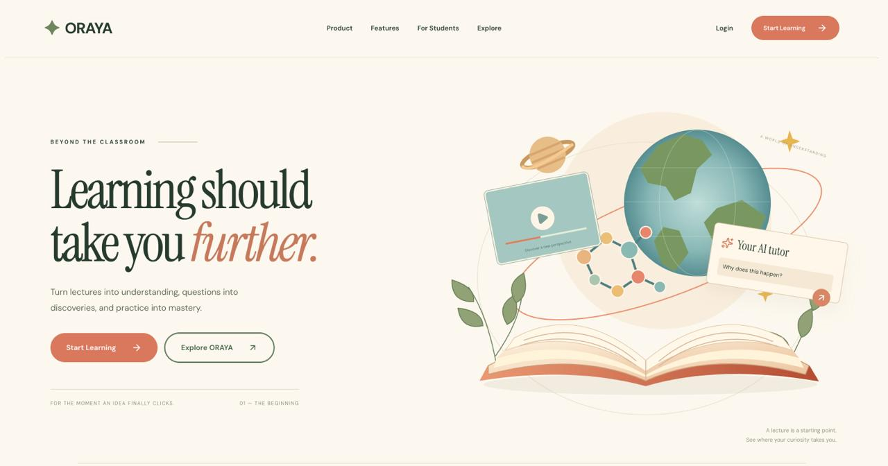
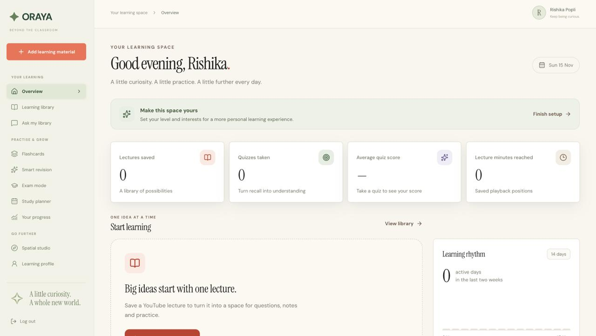
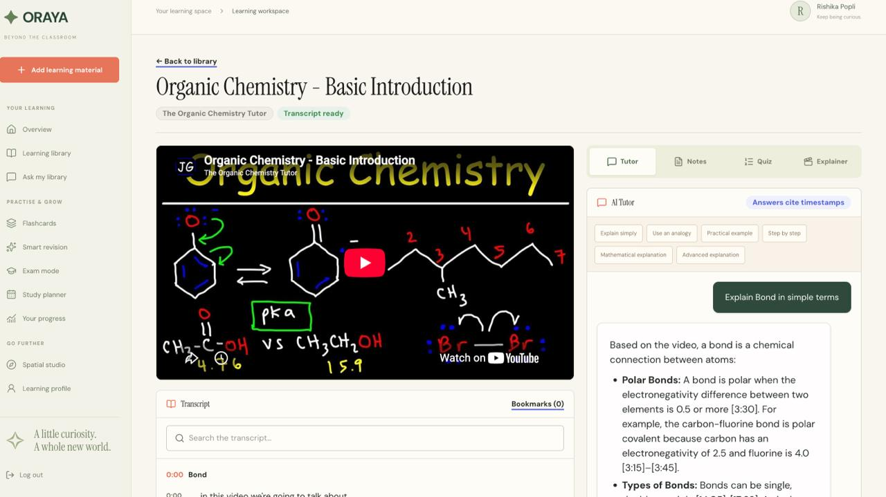
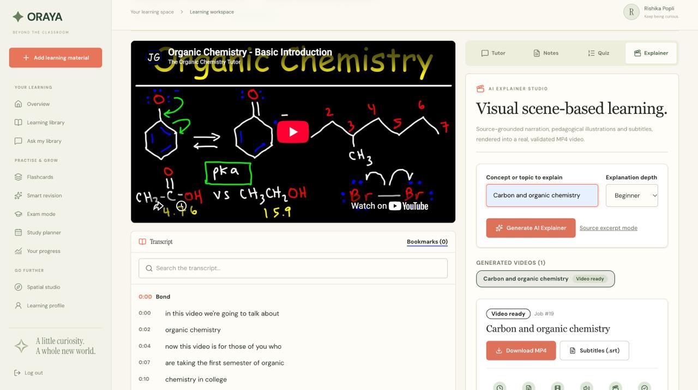
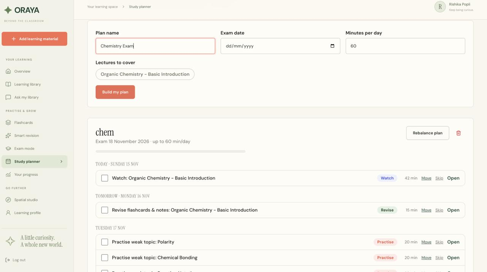
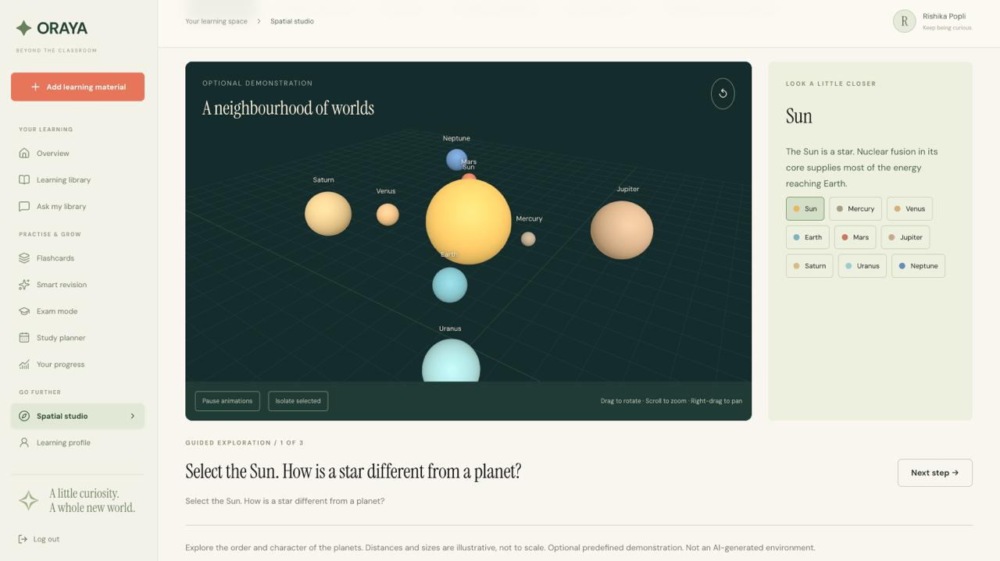
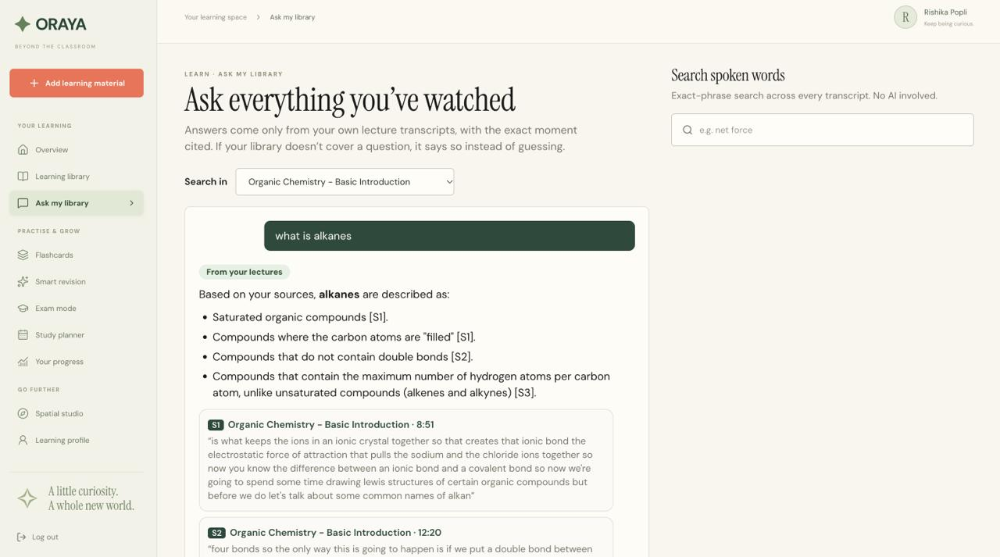
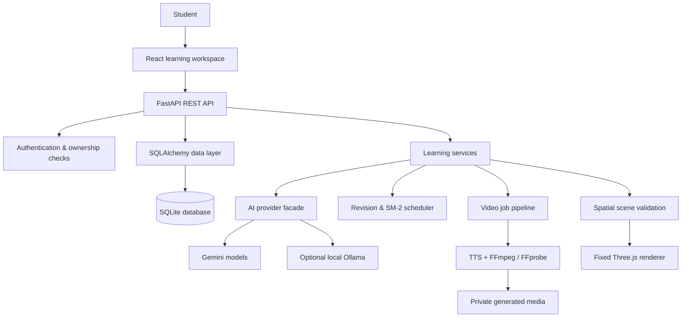

<div align="center">

# ✦ ORAYA

### BEYOND THE CLASSROOM.

**An AI-powered learning space built to help students understand, explore, and retain what they learn.**

[Explore the repository](https://github.com/rishikapopli/ORAYA-AI) · [Report an issue](https://github.com/rishikapopli/ORAYA-AI/issues)

</div>

---

## Overview

ORAYA is a personalized learning platform that brings lectures, learning materials, AI-assisted explanations, revision, and interactive visual exploration into one workspace. Instead of treating learning as a sequence of videos and notes, ORAYA connects study resources to tools that help learners ask questions, practise recall, check understanding, and revisit concepts over time.

The application combines a React frontend with a FastAPI backend. Learning records, revision sessions, and generated learning assets are stored through the backend; AI-powered workflows use configured providers and return explicit errors when those providers are unavailable.

## Product preview

<div align="center">
  
  <p><em>BEYOND THE CLASSROOM.</em></p>
</div>

ORAYA brings the full learning journey into one calm, connected workspace. The screenshots below show the current interface and its core learning experiences.

### Discover ORAYA

<div align="center">
  
  <sub>Landing page — a welcoming introduction to learning beyond the classroom.</sub>
</div>

### Your learning space

<div align="center">
  
  <sub>Dashboard — an at-a-glance view of saved lectures, quiz activity, learning rhythm and next steps.</sub>
</div>

### Learn with your lectures

<div align="center">
  
  <sub>Lecture workspace — video, searchable transcript, bookmarks and contextual AI tutoring in one view.</sub>
</div>

### Create visual explanations

<div align="center">
  
  <sub>AI Explainer Studio — create narrated, subtitled educational explainers from a topic or source excerpt.</sub>
</div>

### Plan your progress

<div align="center">
  
  <sub>Study planner — break an exam goal into manageable watch, revise and practise sessions.</sub>
</div>

### Explore concepts spatially

<div align="center">
  
  <sub>Spatial Studio — explore interactive 3D learning scenes, inspect objects and follow guided prompts.</sub>
</div>

### Ask your library

<div align="center">
  
  <sub>Ask My Library — search across lecture transcripts and get answers grounded in your saved learning sources.</sub>
</div>

### A simple start

<div align="center">
  
  <sub>Account creation — a focused onboarding experience to create a personal learning space.</sub>
</div>

## What you can do with ORAYA

| Workspace | What it does |
|---|---|
| **Learning library** | Upload supported TXT and PDF materials, work with lecture transcripts, and keep learning resources in one place. |
| **AI Tutor** | Ask questions about a lecture and receive source-aware responses with references when a configured AI provider is available. |
| **Notes & study material** | Generate notes with AI or create and manage notes manually. |
| **Flashcards & quizzes** | Create learning cards, practise questions, submit attempts, and review quiz history. |
| **Smart Revision** | Use answer → reveal → recall rating sessions, with saved progress and SM-2 spaced-repetition scheduling. |
| **ORAYA Explainer** | Turn a source excerpt or validated explanation script into a narrated, subtitled educational video. Jobs can be tracked, retried, played, and downloaded. |
| **Spatial Studio** | Explore validated, interactive Three.js learning scenes, inspect objects, follow guided steps, and complete challenges. Optional predefined demonstrations are identified separately from AI-generated environments. |
| **Planner & dashboard** | View learning activity and organize study plans using stored application data. |
| **Memory** | Save and revisit learning-related information in the application. |

> **AI availability:** AI-generated tutor answers, notes, quizzes, scripts, and new spatial scenes require a working provider configuration, model access, quota, and network access. The source archive does not include API credentials. Manual learning tools remain available without Gemini. The project reports provider failures rather than pretending that a mock response is live AI output.

## How it works



### Explainer pipeline

The explainer workflow is a controlled media pipeline rather than arbitrary model-generated code:

1. Prepare and validate an explanation script or source excerpt.
2. Build educational scene visuals using application-controlled rendering.
3. Generate narration using the configured text-to-speech provider.
4. Produce subtitle data and assemble the video with FFmpeg.
5. Validate the resulting media with FFprobe before marking the job complete.

The resulting videos are programmatic educational animations with narration and subtitles; they are not photorealistic generative footage.

### Spatial Studio

Spatial scenes are represented as structured data, validated against application constraints, and rendered using a fixed Three.js geometry vocabulary. Model output is not executed as arbitrary JavaScript, Python, shell commands, or shaders.

## Technology stack

| Layer | Technologies |
|---|---|
| Frontend | React 19, Vite 8, React Router 7, Tailwind CSS 4, Three.js, Lucide React |
| Backend | Python, FastAPI, Uvicorn, Pydantic, SQLAlchemy |
| Database | SQLite for the supported local setup |
| AI | Google Gemini through `google-genai`; optional local Ollama integration |
| Retrieval & documents | Transcript/document ingestion, source-aware context, PDF parsing, lexical search and embedding support |
| Video | Pillow, text-to-speech (macOS `say` or optional gTTS), FFmpeg, FFprobe |
| Testing | pytest, ESLint, TypeScript checks, Vite production build, browser QA scripts |

## Repository structure

```text
ORAYA/
├── frontend/
│   ├── src/
│   │   ├── components/       # Shared UI, shell, player and learning components
│   │   ├── context/          # Authentication context
│   │   ├── lib/              # API client, formatting and job polling
│   │   └── pages/            # Landing and authenticated learning workspaces
│   ├── tests/                # Frontend checks
│   └── package.json
├── backend/
│   ├── app/
│   │   ├── routers/          # FastAPI route modules
│   │   ├── services/         # AI, retrieval, revision, video and spatial services
│   │   ├── models.py         # SQLAlchemy models
│   │   ├── schemas.py        # Request/response schemas
│   │   ├── config.py         # Environment-backed settings
│   │   └── main.py           # FastAPI application and startup
│   ├── tests/                # Backend tests
│   ├── requirements.txt
│   └── .env.example
├── docs/                     # Setup, QA evidence, limitations and screenshots
├── design-system/            # ORAYA design-system reference
├── scripts/                  # Local setup, renderer verification and packaging
└── README.md
```

## Getting started

### Prerequisites

- Python **3.14** (the version used for the supplied verification run)
- Node.js **22 or newer** and npm
- FFmpeg and FFprobe for video rendering
- macOS speech (`say`) for the default local narration provider; alternatively configure the optional gTTS provider
- A Gemini API key for live Gemini-powered features
- Ollama and the configured local model only if you intend to use the optional local AI fallback

The commands below are written for macOS/Linux shells. Run them from the project root unless a command changes directory.

### 1. Set up the backend

```bash
# Install system tools on macOS (Homebrew)
brew install python node ffmpeg

# Create and activate the backend virtual environment
python3 -m venv backend/.venv
backend/.venv/bin/python -m pip install --upgrade pip
backend/.venv/bin/python -m pip install -r backend/requirements.txt

# Generate backend/.env with a private JWT secret
python3 scripts/configure_local.py
```

The setup script preserves an existing backend configuration. Review `backend/.env.example` for the supported settings. If you prefer to create the file manually:

```bash
cp backend/.env.example backend/.env
```

Then edit `backend/.env` locally. At minimum, use a strong private `JWT_SECRET`. Add `GEMINI_API_KEY` to enable Gemini-powered generation. **Never put AI provider keys in frontend environment variables or commit `.env` files.**

### 2. Set up the frontend

```bash
cp frontend/.env.example frontend/.env
cd frontend
npm ci
```

The default frontend API setting is:

```dotenv
VITE_API_URL=/api/v1
```

During local development, Vite proxies `/api` to `http://127.0.0.1:8000`. To use a different backend port, set `VITE_API_PROXY` when starting the Vite server.

### 3. Start the application

Open two terminals from the project root.

**Terminal 1 — backend**

```bash
cd backend
.venv/bin/python -m uvicorn app.main:app --host 127.0.0.1 --port 8000
```

**Terminal 2 — frontend**

```bash
cd frontend
npm run dev -- --host 127.0.0.1 --port 5173
```

Open **http://localhost:5173** and create an account.

Useful local endpoints:

- Frontend: http://localhost:5173
- Backend health: http://127.0.0.1:8000/health
- API documentation: http://127.0.0.1:8000/api/docs
- OpenAPI schema: http://127.0.0.1:8000/api/openapi.json

Stop either process with `Ctrl+C`.

### 4. Configure AI providers

The backend reads its settings from `backend/.env`. The main settings include:

| Variable | Purpose |
|---|---|
| `GEMINI_API_KEY` | Private Gemini API key. Leave blank if not using Gemini. |
| `GEMINI_PRIMARY_MODEL` | First model in the configured Gemini reasoning chain. |
| `GEMINI_FALLBACK_MODEL_1` / `GEMINI_FALLBACK_MODEL_2` | Subsequent Gemini fallback models. |
| `GEMINI_EMBEDDING_MODEL` | Embedding model used for semantic retrieval when configured. |
| `ENABLE_LOCAL_FALLBACK` | Enables the optional Ollama fallback path. |
| `OLLAMA_BASE_URL` | Local Ollama service URL; defaults to `http://127.0.0.1:11434`. |
| `OLLAMA_MODEL` | Local model name; defaults to `qwen3:4b`. |
| `AI_TIMEOUT_MS` | AI request timeout. |
| `AI_RETRY_ATTEMPTS` | Bounded retry count for transient provider failures. |
| `CORS_ORIGINS` | Comma-separated allowed frontend origins. |
| `DATABASE_URL` | Database connection string; the bundled migration runner currently supports SQLite. |
| `STORAGE_DIR` | Private directory for generated media and exports. |
| `TTS_PROVIDER` / `TTS_VOICE` | Narration provider and voice. Default: `macos` / `Samantha`. |
| `FFMPEG_BIN_PATH` / `FFPROBE_BIN_PATH` | Optional explicit binary paths. Blank values use `PATH`. |

The current provider preference is Gemini model failover followed by optional Ollama (`qwen3:4b`). Ollama must be running and the configured model must already be installed. Provider access is not guaranteed by setting a model name; verify credentials, model availability, quota, and network access. After changing backend settings, restart the backend.

Use the authenticated `POST /api/v1/ai/check` endpoint to check configured AI access. Do not set `ALLOW_DEMO_AI=true` to claim that live AI generation has been verified.

## Development & verification

Run checks from the relevant directories:

**Backend tests**

```bash
cd backend
.venv/bin/python -m pytest -q tests
```

**Frontend checks**

```bash
cd frontend
npm run lint
npm run typecheck
npm run build
```

**Renderer verification** (requires FFmpeg/FFprobe and local speech access when using the macOS provider)

```bash
cd ..
python3 scripts/verify_renderer.py
```

### Verification snapshot

The supplied project QA report, dated **15 November 2026**, records:

- Backend: **102 tests passed** (with 3 legacy FastAPI/Starlette deprecation warnings).
- Frontend ESLint: passed.
- Frontend TypeScript check: passed for the typed scene renderer/schema scope; legacy JSX is covered by lint and production compilation rather than a full strict TypeScript conversion.
- Frontend production build: passed; the lazy-loaded Three.js chunk produces a non-fatal size warning.
- Responsive checks were recorded for landing, revision, and spatial screens at desktop, tablet, and mobile viewport sizes.
- A real narrated MP4 was validated with video, audio, and subtitle streams. This verification does not establish that Gemini-authored content was generated live.

These are the results recorded in the included QA report, not a guarantee that every environment or external provider will behave identically. See [`docs/TEST_REPORT.md`](docs/TEST_REPORT.md) for the detailed evidence.

## Current limitations & honest status

- **Live Gemini generation is not verified in the supplied environment.** The archive contains no Gemini key. Tutor responses, generated notes/quizzes, AI-authored video scripts, new spatial scenes, and object tutoring require working credentials, model access, quota, and network access.
- Manual notes, cards, and revision workflows can be used without Gemini.
- The verified no-key video path can narrate selected source excerpts. It is not an AI-authored explanation.
- Explainer videos are programmatic educational animations with narration and subtitles, not cinematic generative footage.
- The default macOS speech provider requires access to the operating system speech service. gTTS is optional, network-dependent, and sends narration to that service.
- Background jobs use bounded in-process workers and SQLite. Run a **single backend process**; this is not a distributed queue or high-availability worker deployment.
- Spatial Studio scenes are educational schematics, not precision physics or medical simulations. WebGL is required.
- YouTube transcript retrieval depends on captions being available remotely. Scanned-PDF OCR, email verification, password reset, distributed job cancellation, and production rate limiting are not included in the current implementation.
- The Render blueprint is provided as a deployment starting point, but the bundled migration runner is SQLite-specific. Do not switch `DATABASE_URL` to PostgreSQL for production without first implementing and verifying compatible migrations and persistence behavior. Persistent storage is also required for uploaded and generated media on ephemeral hosting.

For the full list and the live-provider acceptance checklist, see [`docs/KNOWN_LIMITATIONS.md`](docs/KNOWN_LIMITATIONS.md) and [`docs/FEATURE_COMPLETION.md`](docs/FEATURE_COMPLETION.md).

## Security notes

- Keep `backend/.env` private. Only the API base URL belongs in the frontend environment.
- Use a long, random `JWT_SECRET`; changing it invalidates existing sessions.
- Keep `STORAGE_DIR` private and do not expose uploaded files or generated media through an unrestricted static directory.
- Configure `CORS_ORIGINS` with the exact frontend origins you trust.
- The backend checks ownership for protected learning resources and constrains media downloads to its storage area.
- Do not commit database files, user uploads, generated media, API keys, or virtual environments.

## Further documentation

- [Local setup and run instructions](docs/RUN_INSTRUCTIONS.md)
- [Feature completion matrix](docs/FEATURE_COMPLETION.md)
- [Test report and QA evidence](docs/TEST_REPORT.md)
- [Known limitations and live acceptance checklist](docs/KNOWN_LIMITATIONS.md)
- [Implementation audit](docs/IMPLEMENTATION_AUDIT.md)
- [AI reliability report](docs/AI_RELIABILITY_REPORT.md)
- [Gemini response parsing report](docs/GEMINI_RESPONSE_PARSING_REPORT.md)
- [AI quota and failover report](docs/AI_QUOTA_FAILOVER_REPORT.md)

## Contributing

Contributions, bug reports, and feature suggestions are welcome. For substantial changes, open an issue first to discuss the intended behavior. Please include reproduction steps for bugs and add or update tests for changes to API behavior, persistence, AI provider handling, revision scheduling, or media generation.

## License

No license file was present in the supplied source archive. Unless a license is added to the repository, all rights remain with the copyright holder and reuse is not automatically granted.

---

<div align="center">

**ORAYA — Beyond the Classroom.**  
*Learn with context. Practise with purpose. Explore beyond the page.*

</div>
